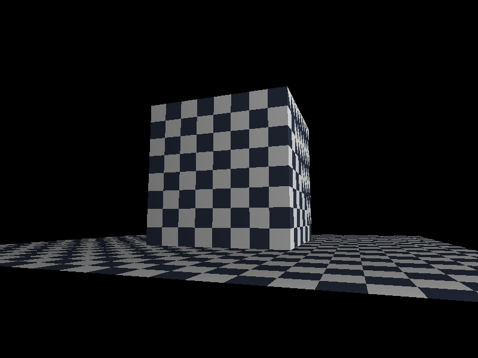
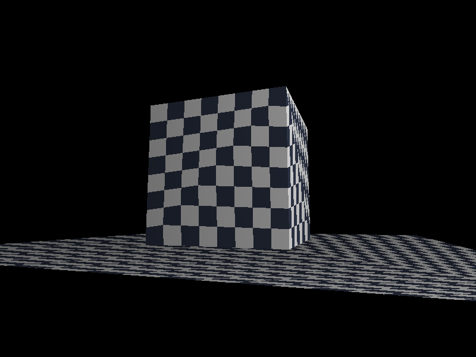
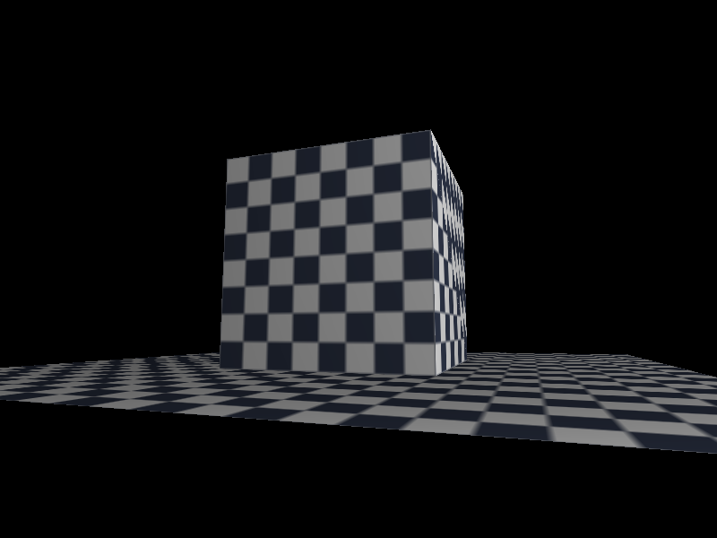

# 第 10 步：纹理 + 透视校正（实现篇）

> 目标：把纯色立方体换成「贴图立方体」——每个面贴一张棋盘格，并且贴得**近大远小、不扭曲**。

> **验收标准（学习路线原文）**：地板上铺棋盘格，近处格子大、远处格子小且不扭曲。
> 并且按路线要求做了**对照实验**：把「不做透视校正」的版本和「做校正」的版本各截一张图，亲眼看一次扭曲长什么样。

---

## 一、这一步在做什么

| # | 做什么 | 动到的文件 |
| :---: | :--- | :--- |
| ① | 新建纹理模块：一张像素图 + 两种采样方式（最近邻 / 双线性）+ 代码生成棋盘格 | `src/core/texture.hpp` `.cpp`（新建） |
| ② | `Vertex` 加上 UV（纹理坐标） | `src/scene/vertex.hpp` |
| ③ | 光栅化里加「透视校正插值」：按 `u/w`、`v/w`、`1/w` 插值再相除 | `src/render/rasterizer.*` |
| ④ | 渲染入口加纹理版本 `draw_filled_textured`（顺手存下 `1/w`） | `src/render/renderer.*` |
| ⑤ | 主程序：立方体 + 地板都贴棋盘格，加 T / B 两个键做对照实验 | `src/main.cpp` |

新增的依赖关系不变：`core/texture` 属于 `core/` 层，**只依赖 `core/` 自己**，不碰 `math`、不碰 `scene`。

---

## 二、UV 是什么

### 2.1 一个改动就能理解

以前顶点只有「在哪」（位置）和「朝哪」（法线）。现在要多一个信息：

> **这个顶点，对应图上哪个点？**

这个「图上的位置」就是 **UV**（也叫纹理坐标）。它是一对 `0~1` 的小数：

```
uv = (u, v)
u = 0 在图的左边，u = 1 在右边
v = 0 在图的上面，v = 1 在下面
```

所以一张图的四个角就是：

| 角 | uv |
| :--- | :--- |
| 左上 | `(0, 0)` |
| 右上 | `(1, 0)` |
| 左下 | `(0, 1)` |
| 右下 | `(1, 1)` |

### 2.2 为什么 `v` 是「向下」的

因为这样 `v × 图的高度` 直接就是**行号**，不用翻转。

OpenGL 的惯例是「原点在左下角、v 向上」，所以用 OpenGL 纹理时要翻转一次。**两个约定没有对错，关键是全项目统一。**

本项目在 `texture.cpp` 顶部把这条约定写死了：原点左上角、v 向下。

### 2.3 UV 超出 `[0,1]` 会怎样

会**重复平铺**（tiling）——图在平面上像瓷砖一样一块接一块地铺下去。

这不是 bug，是特性。地板那种一眼望不到头的平面，就是靠一张小图铺满的：UV 取「世界坐标 ÷ 2」，铺出去就是无数个重复的棋盘。

代码在 `Texture::texel()` 里做了一次 wrap：

```cpp
// 用 ((v % n) + n) % n 而不是 v % n：后者在 v 为负时结果是负的
static int wrap_index(int v, int n) { return ((v % n) + n) % n; }
```

**注意 `+n` 那一半**：`u = -1.5` 时 `-1.5 % 64` 在 C++ 里是负数（C++ 的取模符号跟着被除数走），必须加一次 `n` 再取模，才能绕回正确的一侧。

### 2.4 立方体的 UV 怎么给

最省事的给法：**每个面都铺满一整张贴图**，也就是该面的 4 个角分别对应 `(0,0) (1,0) (0,1) (1,1)`。

同一张棋盘格贴在 6 个面上，转起来能看到每个面因为朝向、距离不同，格子大小也跟着不一样——这本身就是一次「近大远小」的直观演示。

---

## 三、贴图怎么取色：两种采样

有了 uv，取颜色就是「把 uv 换算成像素下标，然后取那个像素」。

```
像素 x = u × 图宽
像素 y = v × 图高
```

但算出来是小数（比如 `x = 12.7`），落在像素之间。怎么办？两种流派：

| 方式 | 做法 | 效果 | 代价 |
| :--- | :--- | :--- | :--- |
| **最近邻**（nearest） | 直接向下取整，取 `x = 12` 那个像素 | 放大后是马赛克一样的硬边 | 便宜 |
| **双线性**（bilinear） | 取周围 4 个像素，按距离加权平均 | 放大后是平滑过渡 | 贵一点（4 次取样 + 混合） |

**先写最近邻跑通，再升级双线性**（学习路线 4.2 的原话）。本项目两种都实现了，用 `B` 键切换对比。

### 双线性里的一个坑：减半格

```cpp
// 减半格：让 u = 0 落在「第一个像素的中心」，而不是它的左上角。
// 不减的话整张贴图会往右下偏半格，放大后能看出来。
const float fx = u * static_cast<float>(width_) - 0.5f;
```

像素不是一个「点」，是一个 `1×1` 的小方格，它的坐标是**中心点**。`u = 0` 应该对应第 0 个像素（中心在 `0.5`），所以要先减 `0.5` 对齐，否则整张图会系统性偏半格。

---

## 四、透视校正：本步的核心

### 4.1 问题：UV 不能直接线性插值

光栅化时，我们靠**重心坐标**在三角形内部插值。位置、深度这些都可以直接线性插值。

但 **UV 不行**。

原因一句话：**屏幕上等长的一段，在世界里并不等长。**

### 4.2 一个能算出来的例子

想象地板上从近到远一条线段，两端：

- 近端：深度 `w₀ = 2`（相机前 2 个单位）
- 远端：深度 `w₁ = 10`

设参数 `t` 是**世界空间**里的插值系数：`t = 0` 在近端，`t = 1` 在远端。

现在问：**屏幕上这条线段的「正中间」（重心坐标 α = 0.5）那个像素，对应的 `t` 是多少？**

- 如果按「直接线性插值」：会得到 `t = 0.5`，也就是「世界的中点」。
- 正确答案：

```
        α · t₀/w₀ + α · t₁/w₁     0.5·(0/2) + 0.5·(1/10)     0.05
t  =  ───────────────────────  =  ────────────────────  =  ──────  = 0.1667
              α/w₀ + α/w₁            0.5/2 + 0.5/10          0.30
```

**`t = 1/6`，不是 `1/2`。**

也就是说：屏幕的中心，实际对应的是**世界中的 1/6 处**。因为近处占了屏幕上很大一块。用线性插值会得到 `t = 0.5`，误差 3 倍——这就是贴图被拉伸的根源：**远端的纹理内容被硬生生摊到了远端的半个屏幕上**。

### 4.3 正确做法

数学上能证明：**`1/w` 在屏幕空间是线性的，`u/w` 和 `v/w` 也是。** 但 `u`、`v` 本身不是。

于是：

```
① 在屏幕空间线性插值 u/w、v/w、1/w   ← 这三步合法
② 再除回来：u = interp(u/w) / interp(1/w)
```

多出来的代价只有每像素两次乘加和一次除法。

### 4.4 代码长这样

[rasterizer.cpp](file:///d:/SDL_project/softbymyself/src/render/rasterizer.cpp#L412-L435)：

```cpp
float u, v;
if (perspective_correct) {
    // 插值 1/w，以及 u/w、v/w —— 这三个在屏幕空间都是线性的
    const float iw = a0 * v0.invw + a1 * v1.invw + a2 * v2.invw;
    if (iw > 0.0f) {
        const float uw = a0 * v0.u * v0.invw
                       + a1 * v1.u * v1.invw
                       + a2 * v2.u * v2.invw;
        const float vw = a0 * v0.v * v0.invw
                       + a1 * v1.v * v1.invw
                       + a2 * v2.v * v2.invw;
        u = uw / iw;    // 除回来，才是这个像素真正对应的 UV
        v = vw / iw;
    } else {
        // 理论上到不了这里：renderer 已经把 w 太小的顶点剔掉了
        u = a0 * v0.u + a1 * v1.u + a2 * v2.u;
        v = a0 * v0.v + a1 * v1.v + a2 * v2.v;
    }
} else {
    // 对照实验用的错误做法：把 uv 当普通属性线性插值
    u = a0 * v0.u + a1 * v1.u + a2 * v2.u;
    v = a0 * v0.v + a1 * v1.v + a2 * v2.v;
}
```

`invw` 是渲染时就算好存进去的，不在光栅化里现算：

[renderer.cpp](file:///d:/SDL_project/softbymyself/src/render/renderer.cpp#L181)：

```cpp
sv[i].invw  = 1.0f / clip.w;     // 透视校正的关键：存 1/w，不存 w
```

### 4.5 为什么 `ScreenVertex` 要打包成一个结构体

因为每个顶点现在有 7 个字段（`x y z invw u v light`），如果全拆成函数参数，光栅化函数的参数会超过 20 个，没法读也没法改。打包成结构体后函数签名只有「3 个顶点 + 纹理 + 2 个开关」。

[rasterizer.hpp](file:///d:/SDL_project/softbymyself/src/render/rasterizer.hpp)：

```cpp
struct ScreenVertex {
    int   x = 0;
    int   y = 0;
    float z = 0.0f;         // NDC 的 z，深度测试用
    float invw = 1.0f;      // 1 / clip.w，透视校正的分母
    float u = 0.0f;
    float v = 0.0f;
    float light = 1.0f;
};
```

---

## 五、贴图怎么和光照合起来

第 9 步算出来的「亮度」是一个 `0~1` 的数。贴图后最终颜色就是：

```
最终颜色 = 贴图颜色 × 光照亮度
```

所以第 9 步的 `compute_lambert()` 被拆了：新增一个只返回亮度（不带基色）的函数。

[lighting.cpp](file:///d:/SDL_project/softbymyself/src/render/lighting.cpp)：

```cpp
float lambert_intensity(const Vec3& normal, const Vec3& light_dir, float ambient)
{
    const float diffuse = std::max(0.0f, dot(normal, light_dir));
    return ambient + (1.0f - ambient) * diffuse;   // 0~1 的亮度
}
```

光栅化里乘上去：

```cpp
Color modulate(const Color& c, float light)   // 逐通道 min(255, 值 × light)
...
fb.put_pixel(x, y, modulate(texel, light));
fb.set_depth(x, y, z);
```

**注意一个细节**：`light` 是 `0~1` 的标量，跟随 uv 一起做透视校正的影响非常小，所以这里是**直接线性插值**的，没做校正。位置和深度同理——位置不用插值（屏幕坐标就是它自己），深度（NDC z）在屏幕空间本来就是线性的。

---

## 六、对照实验：亲眼看一次扭曲

这是学习路线明确要求的：**「这个扭曲现象要亲眼看一次，否则以后在真实项目里遇到，你认不出来。」**

程序里按 `T` 键切换透视校正（关掉时走上面那段「错误做法」的分支），按 `B` 键切换采样方式。

另外为了能做客观对照，用一个临时程序（`SDL_SaveBMP` 存盘）在**固定的贴地视角**下各渲染一张图——因为「斜着看的大平面」上扭曲最明显：

| 透视校正 **开**（正确） | 透视校正 **关**（错误） |
| :---: | :---: |
|  |  |
| 格子是**规整的正方形**，越远越小，边界是**直线** | 格子被拉成**弧形条纹**，远处糊成一片，边界**弯了** |

**怎么读这两张图：**

- 左图：近处格子大、远处格子小，但每一格仍然是个正方形。这就是「近大远小、不扭曲」。
- 右图：本该是直线的格子边界弯成了弧线，远处的格子被拉伸得几乎糊成条纹——因为远端的纹理被错误地摊到了更大的一块屏幕上。

像素级客观差异：两张图有 **31018** 个像素不同（占 800×600 的 6.5%），肉眼一眼就能分辨。

双线性采样的版本（近处格子边缘更平滑）：



---

## 七、一个必须先解决的坑：地板为什么不能铺大

这一条不属于「纹理」，但它是这一步最重要的踩坑记录。

**现象**：第一版把地板铺成 12×12，结果**整张图全黑**，只剩清屏色。

**根因**：项目**还没有做裁剪**（那是第 11 步）。

[renderer.cpp](file:///d:/SDL_project/softbymyself/src/render/renderer.cpp#L171-L175) 里对 `w` 太小的顶点直接丢弃：

```cpp
if (clip.w < 1e-6f) {
    // w 太小（顶点贴在相机平面上甚至背后），透视除法会炸，直接丢掉
    visible[i] = false;
    continue;
}
```

而三角形只要**有一个顶点的 `visible == false`，整个三角形就被跳过**：

```cpp
if (!visible[a] || !visible[b] || !visible[c]) continue;
```

地板铺到 12×12 时，角点 `(6, -1, 6)` 相对相机已经跑到**相机背后**了 → 包含这个角的两个三角形全被丢掉 → 什么都不画 → 黑屏。

**定量约束**：要让地板永远完整，必须保证

```
√(半边长x² + 半边长z² + 1²)  <  相机到原点的距离 r
```

最终取值：地板半边长 3（6×6），`y = -1`，最远的角到原点 `√(3²+3²+1²) ≈ 4.36`；相机距离 `r = 5`（`4.36 < 5` ✓）。

**顺带一个约束**：相机要能压到「贴地」角度（扭曲最狠的视角），但俯角不能低到钻到地板下面去，所以 `pitch` 的下界要满足 `r · sin(pitch) > -1`（地板高度）。`r = 5` 时下界取 `-7.5°`，此时相机高度约 `-0.65`，还在地板之上。

**这条约束本身就是一个教学点**：它解释了「为什么第 11 步必须做裁剪」——不做裁剪，你连一块正常大小的地板都铺不出来。

---

## 八、本步新增/修改的文件

| 文件 | 状态 | 职责 |
| :--- | :--- | :--- |
| `src/core/texture.hpp` / `.cpp` | **新建** | 纹理：像素存储、wrap、最近邻/双线性采样、棋盘格生成 |
| `src/scene/vertex.hpp` | 改 | `Vertex` 加 `Vec2 uv` |
| `src/render/lighting.hpp` / `.cpp` | 改 | 新增 `lambert_intensity()`（只返回亮度） |
| `src/render/rasterizer.hpp` / `.cpp` | 改 | 新增 `ScreenVertex`、`draw_triangle_textured()`（含透视校正开关） |
| `src/render/renderer.hpp` / `.cpp` | 改 | 新增 `draw_filled_textured()` |
| `src/main.cpp` | 改 | 立方体 + 地板贴棋盘格；T / B 键对照实验 |
| `CMakeLists.txt` | 改 | 加入 `src/core/texture.cpp` |

**分层检查**：`texture.hpp` 只 `#include "core/color.hpp"`，没有 `#include vec.hpp`——采样接口只收 `float u, float v`，就是为了不破坏「`core/` 不依赖 `math/`」这条规则。

---

## 九、自测题

1. UV 的 `v` 在本项目里是向上还是向下？为什么这么定？
2. UV 取 `1.7` 会发生什么？靠哪个函数保证不越界？
3. 为什么 `wrap_index` 里要写 `((v % n) + n) % n`，直接 `v % n` 会出什么问题？
4. 为什么 UV 不能像深度那样直接线性插值？用一句话说清楚。
5. `1/w` 在屏幕空间是线性的，`u` 是不是？
6. 双线性采样为什么要把坐标减 `0.5`？
7. 地板铺大了为什么会整张图黑屏？这和哪一步有关？

**答不上来的，说明那一节没讲透——告诉我哪一题，我重写那一节。**

---

## 十、这一步的产出物

| 产出物 | 可展示点 |
| :--- | :--- |
| 透视图校正对照图（本步截图） | 作品集里最有说服力的一页：**「我知道为什么贴图会扭曲，也知道怎么修」** |
| `core/texture` 模块 | GitHub 仓库里一个独立、可复用的纹理模块 |
| 棋盘格立方体 + 地板 Demo | 渲染管线第一个「看起来是真三维场景」的画面 |

**面试关联**：透视校正插值是渲染岗和 TA 岗的高频考点，典型问法就是「为什么贴图必须除以 w？」——本步的两张对照图就是最好的回答素材。

---

## 十一、下一步

第 11 步：**背面剔除 → 视锥剔除 → 裁剪**（三个按这个顺序做，从易到难）。

其中「裁剪」正好补上本步那个坑：做完裁剪，地板就能铺到任意大，相机贴脸时也不会再有三角形飞出去。