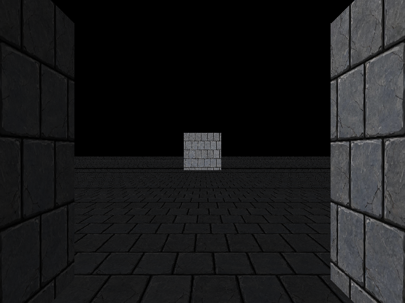
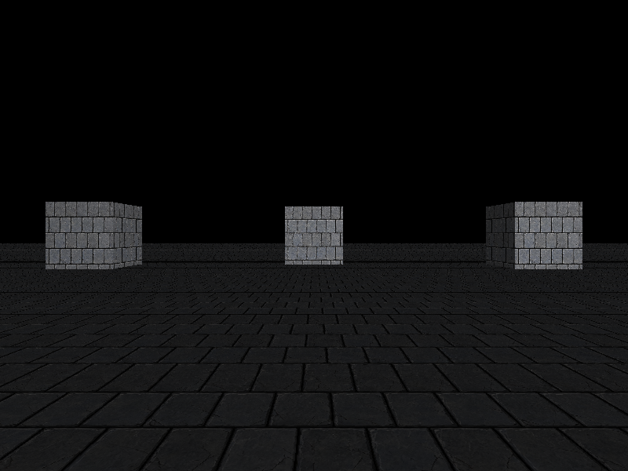
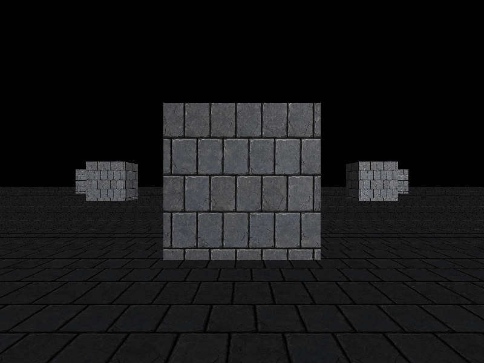

# 第 11 步：背面剔除 + 视锥剔除 + 裁剪（实现篇）

> 目标：给管线补齐三个「不画看不见的东西」的机制——**背面剔除 → 视锥剔除 → 裁剪**（按学习路线要求的顺序，从易到难）。

> **验收标准（学习路线原文）**：背面不显示；相机贴脸时没有三角形飞出。
> 本步额外做了两件验收：**地板铺到地平线、怎么转都不缺块**（第 10 步那个「地板不敢铺大」的坑正式解除），以及**「可见 N / M」随视角变化**（证明视锥剔除真的在剔除）。

---

## 一、这一步在做什么

| # | 做什么 | 动到的文件 |
| :---: | :--- | :--- |
| ① | **背面剔除**：屏幕空间有向面积 `<= 0` 的三角形，填像素前整块丢掉 | `src/render/rasterizer.*` |
| ② | **近平面裁剪**：Sutherland-Hodgman 把跨过近平面的三角形切开 | `src/render/clipper.hpp` `.cpp`（新建） |
| ③ | 渲染入口接入裁剪：顶点不再丢，全部留到裁剪空间再逐个三角形切 | `src/render/renderer.cpp` |
| ④ | **包围盒**：`Aabb`，算包围盒、变换包围盒 | `src/scene/aabb.hpp` `.cpp`（新建） |
| ⑤ | **视锥体**：从 view-projection 矩阵抠出 6 个平面，跟包围盒求交 | `src/scene/frustum.hpp` `.cpp`（新建） |
| ⑥ | **场景**：一堆物体，逐个打 `visible` 标记 | `src/scene/scene.hpp` `.cpp`（新建） |
| ⑦ | 主程序改成 Scene 驱动 + 大地板 + 两圈小立方体；改 CMake | `src/main.cpp`、`CMakeLists.txt` |

分层原则不变：`clipper` 在 `render/`（依赖 `math/`），`aabb` / `frustum` / `scene` 在 `scene/`（依赖 `math/`）。新增文件**没有一个**碰 SDL——认识 SDL 的永远只有 `core/window.cpp`、`io/image.cpp`、`src/main.cpp`。

---

## 二、背面剔除：最省事的一个

### 2.1 一个立方体，永远有一半的三角形你看不见

一个立方体 12 个三角形。不管从哪个角度看，永远有 6 个是**背对你**的——它们的正面对着墙的另一侧。

既然看不见，就别画。这一刀在**填像素之前**砍掉，等于白省一半的填充开销，而且只需要几行整数加法，不需要任何额外状态（不像深度测试那样还要一张深度图）。

### 2.2 怎么判「正反」：屏幕空间的有向面积

把三角形的三个屏幕坐标拿来，算：

```
area2 = (x1 - x0) * (y2 - y0) - (x2 - x0) * (y1 - y0)
```

这是**有向面积的两倍**，符号代表绕序。

**本项目的判据**（[rasterizer.cpp](file:///d:/SDL_project/softbymyself/src/render/rasterizer.cpp#L92-L121)）：

> 屏幕坐标 x 向右、y 向下，**正面朝你的三角形，`area2 > 0`**。

```cpp
// 背面剔除：屏幕空间有向面积判断这个三角形是不是背对着相机。
//
//   area2 = (x1-x0)*(y2-y0) - (x2-x0)*(y1-y0)
//
// 判据（本项目采用的、也是屏幕空间里最省事的说法）：
//   屏幕坐标 x 向右、y 向下，**正面朝你的三角形，area2 > 0**。
// 等价说法：在物体外表面所在平面上、改用「x 向右 y 向上」的常规坐标系看，
// 正面三角形的顶点顺序是**顺时针（CW）**。
// （OpenGL 默认约定的正面是 CCW —— 那是「窗口 y 向上」的坐标系；本项目屏幕
//   y 向下，两者是同一个绕序在两种坐标轴朝向下换了符号，判定不受影响。
//   第 11 步实测过：把正面顶点代进去，area2 正好是正的。）
bool back_facing(int x0, int y0, int x1, int y1, int x2, int y2)
{
    const int area2 = (x1 - x0) * (y2 - y0) - (x2 - x0) * (y1 - y0);
    return area2 <= 0;
}
```

### 2.3 一个必须记牢的坑：CW 还是 CCW？

学图形学时你会看到两种说法，第一次一定会被绕晕：

| 说法 | 前提 | 正面绕序 |
| :--- | :--- | :--- |
| OpenGL 默认 | 窗口坐标 **y 向上** | **逆时针（CCW）** |
| 本项目（屏幕 y 向下） | 屏幕坐标 **y 向下** | 看起来是**顺时针（CW）** |

**它们是同一个绕序，只是坐标轴朝向反了，符号跟着反。**「CW / CCW」这种说法本身不自足——**必须带上「哪个坐标轴朝哪」才有意义**。

所以更省事、更不会记错的写法是直接说**符号**：

> 屏幕 y 向下时，正面 `area2 > 0`。

学到这一步最容易犯的错，是把立方体的顶点按「屏幕上看起来顺时针」去写——结果坐标系一换，整套模型**整体消失**（所有面都被判成背面）。下面第五节那个 bug 就是它的变种。

### 2.4 为什么必须在「投影之后」判

`area2` 用的是**屏幕坐标**，也就是顶点做完 MVP、透视除法、视口变换之后的整数像素坐标。

不能在世界空间用叉积判正反——世界空间的法线方向判断不了「相机在面的哪一侧」。投影这一步把「面朝不朝相机」压缩进了**屏幕上的绕序符号**里，所以判正反只需要看面积符号。

**副作用**：`back_facing` 里 `area2 == 0` 也当成背面丢掉（`<= 0`）。三点重合或共线时画不出东西，一并扔掉正好。

---

## 三、近平面裁剪：最难的一个

### 3.1 为什么必须做

第 10 步的「地板不能铺大」就是这个问题的症状。

透视除法要**除以 w**。而 w 的正负号代表「在相机前面还是后面」。相机背后的点 `w <= 0`，除完 `x`、`y` 会**整块翻号**——一个本来在左边的点，除完跑到右边去，屏幕上就出现横穿全屏的**鬼畜三角形**，甚至整块画面糊掉。

第 10 步的偷懒办法是「`w` 太小的顶点直接丢掉，用到它的三角形整块不画」。代价就是地板铺到 12×12 时，角点跑到相机背后 → 含这个角的两个三角形全没了 → **地板缺一块**。

正确的做法：**不是丢顶点，是把跨过近平面的三角形切开**，切掉相机背后那一半，保留前面那一半。

### 3.2 关键：在透视除法**之前**做

管线顺序是：

```
顶点变换（乘 MVP，仍是齐次坐标）→ 【近平面裁剪】→ 透视除法 → 视口变换 → 光栅化
```

**裁剪必须在透视除法之前。** 因为裁剪要处理的正是「w ≤ 0」这些点，而一旦除了 w，坐标就已经翻了号，信息就丢了。

### 3.3 近平面怎么判：`z + w >= 0`

[clipper.hpp](file:///d:/SDL_project/softbymyself/src/render/clipper.hpp#L43-L46)：

```cpp
// 「近平面」怎么判：clip.z + clip.w >= 0。
//   投影矩阵把近平面映射到 NDC 的 z = -1，也就是 clip.z = -clip.w，
//   所以 z + w 的符号正好区分「在近平面之前（保留）」和「之后（丢掉）」。
//   对正交投影同样成立（正交时 w 恒为 1，近平面 z = -1 → z + 1 = 0）。
```

透视投影矩阵把近平面映射到 NDC 的 `z = -1`。而 NDC 的 `z = clip.z / clip.w`，所以近平面就是 `clip.z / clip.w = -1`，也就是 `clip.z = -clip.w`，即 **`clip.z + clip.w = 0`**。

于是：

- `z + w >= 0` → 在近平面**内侧**（保留）
- `z + w < 0` → 在近平面**外侧**（丢掉）

[clipper.cpp](file:///d:/SDL_project/softbymyself/src/render/clipper.cpp#L17-L21)：

```cpp
// 平面函数：>= 0 在近平面内侧（保留），< 0 在外侧（丢掉）
float plane_distance(const ClipVertex& v)
{
    return v.position.z + v.position.w;
}
```

### 3.4 Sutherland-Hodgman：沿着边走一圈

算法一句话版本：**沿着多边形的边走一圈，对每条边 (cur → nxt) 问两件事**：

1. `cur` 在平面内侧吗？在就把它留下来。
2. 这条边跨过平面了吗？跨了就补一个交点。

对三角形来说，切一刀的结果只可能是三种：**空**（全在外）、**三角形**（全在内）、或者**四边形**（一个角被切掉）。所以临时数组开 4 个位置就够。

[clipper.cpp](file:///d:/SDL_project/softbymyself/src/render/clipper.cpp#L36-L74)：

```cpp
int clipper::clip_near_plane(const ClipVertex in[3], ClipVertex out[kMaxOutputTriangles * 3])
{
    // ---- 第一步：切一刀，得到 0 ~ 4 个顶点的多边形 ----
    ClipVertex poly[4];
    int count = 0;

    for (int i = 0; i < 3; ++i) {
        const ClipVertex& cur = in[i];
        const ClipVertex& nxt = in[(i + 1) % 3];

        const float d_cur = plane_distance(cur);
        const float d_nxt = plane_distance(nxt);
        const bool  cur_in = (d_cur >= 0.0f);
        const bool  nxt_in = (d_nxt >= 0.0f);

        // ① 当前顶点在内侧 → 留下
        if (cur_in) {
            poly[count++] = cur;
        }
        // ② 这条边的两端一内一外 → 补一个交点
        //    交点比例：d(t) = d_cur + t * (d_nxt - d_cur) = 0  →  t = d_cur / (d_cur - d_nxt)
        if (cur_in != nxt_in) {
            const float t = d_cur / (d_cur - d_nxt);
            poly[count++] = lerp_vertex(cur, nxt, t);
        }
    }

    // ---- 第二步：把多边形扇成三角形 ----
    // 拿 poly[0] 当扇心，和后面每两个相邻点组成一个三角形：
    //   0 个点 → 没有输出；3 个点 → 1 个三角形；4 个点 → 2 个三角形。
    // 切分不改变绕序，所以切完照样能做背面剔除。
    int triangles = 0;
    for (int i = 1; i + 1 < count; ++i) {
        out[triangles * 3 + 0] = poly[0];
        out[triangles * 3 + 1] = poly[i];
        out[triangles * 3 + 2] = poly[i + 1];
        ++triangles;
    }
    return triangles;
}
```

**交点的 `t` 怎么来的**：平面函数 `d` 沿边是线性的，`d(t) = d_cur + t·(d_nxt - d_cur)`。要让 `d(t) = 0`（正好落在平面上），解出

```
t = d_cur / (d_cur - d_nxt)
```

### 3.5 为什么裁剪**天生**就是透视正确的

这是本步最容易想不通、也最值得想通的一点。

光栅化里做 UV 插值，必须除以 `1/w` 做透视校正（第 10 步）。但裁剪里插值 UV，**直接线性插就用对了**，一次校正都不用做。为什么？

> **裁剪空间坐标是世界坐标的线性函数。** `clip = MVP · p`，里面只有矩阵乘法，**没有除法**。所以同一条边上，「裁剪空间里的插值参数 t」和「世界空间里的 t」是**同一个数**。拿这个 t 去插值顶点属性，得到的就是世界空间里的真值。

换句话说：**透视除法之前，一切都是线性的**——包括那些「必须透视校正」的属性。只有除了 w 之后，屏幕空间才和世界空间分家，才需要 `1/w` 把差异补回来。

[clipper.hpp](file:///d:/SDL_project/softbymyself/src/render/clipper.hpp#L18-L22) 把这个结论写在注释里：

```cpp
//  为什么这里插值天生就是透视正确的（不用像光栅化那样再除 1/w）：
//    裁剪空间坐标是世界坐标的**线性函数**（clip = MVP · p，没有除法）。
//    同一条边上，裁剪空间的插值参数 t 和世界空间的 t 是**同一个**。
//    拿这个 t 去插值顶点属性，得到的就是世界空间里的真值。
//    哪一天你想不通「为什么裁剪不用透视校正」，回来读这三行。
```

`lerp_vertex` 就是把**同一个 t** 用到所有属性上（[clipper.cpp](file:///d:/SDL_project/softbymyself/src/render/clipper.cpp#L23-L32)）：

```cpp
// 在两个顶点之间按 t 插出新的裁剪顶点。
// 位置、UV、亮度全都跟着**同一个 t** 线性插 —— 这就是上面说的「天生透视正确」。
ClipVertex lerp_vertex(const ClipVertex& a, const ClipVertex& b, float t)
{
    ClipVertex r;
    r.position = lerp(a.position, b.position, t);
    r.uv       = lerp(a.uv, b.uv, t);
    r.light    = a.light + (b.light - a.light) * t;
    return r;
}
```

### 3.6 这一版只裁近平面

[clipper.hpp](file:///d:/SDL_project/softbymyself/src/render/clipper.hpp#L48-L50)：

```cpp
// 注意这一版**只裁近平面**：远平面/左右上下四个面不裁。
// 那四个面不裁不会画出穿屏的东西（除以 w 不会炸），只是会多算一些屏幕外的像素，
// 交给光栅化时的包围盒越界判断兜掉就行。完整的六面裁剪留作练习。
```

剩下 5 个面不裁**不会出错**——因为它们的 `w > 0`（都在相机前面），除以 w 是安全的，最多算出一些屏幕外的像素，光栅化的包围盒一夹就没了。**只有近平面特殊**，因为它是唯一会碰到「w ≤ 0」的那一侧。

### 3.7 渲染入口怎么改

[renderer.cpp](file:///d:/SDL_project/softbymyself/src/render/renderer.cpp#L185-L225)——核心变化是**顶点一个都不丢**，全部以裁剪空间坐标留着：

```cpp
    // ---- ① 顶点变换：只乘到裁剪空间，不除法、不丢点 ----
    ClipVertex clip_vertices[kMaxVertices];
    for (int i = 0; i < vertex_count; ++i) {
        clip_vertices[i].position = mvp * vertices[i];
        clip_vertices[i].uv       = uvs[i];
        clip_vertices[i].light    = intensities[i];
    }

    // ---- ② 逐三角形：裁剪 → ③ 透视除法 + 视口 → ④ 光栅化 ----
    for (int t = 0; t < triangle_count; ++t) {
        const ClipVertex input[3] = {
            clip_vertices[triangles[t][0]],
            clip_vertices[triangles[t][1]],
            clip_vertices[triangles[t][2]],
        };

        ClipVertex output[clipper::kMaxOutputTriangles * 3];
        const int piece_count = clipper::clip_near_plane(input, output);

        for (int p = 0; p < piece_count; ++p) {
            ScreenVertex sv[3];
            for (int k = 0; k < 3; ++k) {
                const ClipVertex& cv = output[p * 3 + k];

                // 裁剪保证了 w >= near > 0，所以这里的除法是安全的
                const Vec4 ndc = cv.position.perspectiveDivide();
                viewport(ndc.x, ndc.y, fb.width(), fb.height(), sv[k].x, sv[k].y);

                sv[k].z     = ndc.z;                    // 深度测试用
                sv[k].invw  = 1.0f / cv.position.w;     // 透视校正的关键：存 1/w
                sv[k].u     = cv.uv.x;
                sv[k].v     = cv.uv.y;
                sv[k].light = cv.light;
            }

            draw_triangle_textured(fb, sv[0], sv[1], sv[2],
                                   texture, perspective_correct, bilinear);
        }
    }
```

**注意 `w` 现在一定大于 0**：近平面裁剪保留的是 `z_view <= -near` 的部分，对透视投影 `w = -z_view`，所以 `w >= near > 0`。除法安全，`1/w` 也不会除零。

**还有一点**：裁剪输出的是「四边形扇成的两个三角形」，这个切分**保持绕序**——所以切完的碎块照样能做背面剔除，两件事不冲突。

---

## 四、视锥剔除：CPU 侧的事

前两个都在顶点/像素层，这个是**物体层**的：一整块模型整个在视野外，就连它的三角形都不用送进管线。

### 4.1 包围盒：把模型装进一个盒子

判断「模型在不在视野里」，拿每个顶点去比太慢。先用一个**轴对齐包围盒**（AABB）把模型包起来，盒子在视野外 → 模型一定也在外面。

盒子存成两个角 `min`、`max`，一共 6 个数，比存几百个顶点便宜得多。

本项目立方体的顶点已经是「外表面点集」，所以 `Aabb::from_positions()` 扫一遍取 min/max 就是盒子（[aabb.cpp](file:///d:/SDL_project/softbymyself/src/scene/aabb.cpp#L7-L29)）。

**一个细节**：盒子要跟着模型矩阵搬到世界空间。但轴对齐盒被旋转之后**一般不再是轴对齐的**，所以做法是**把 8 个角都变一遍，再重新包一个盒**（[aabb.cpp](file:///d:/SDL_project/softbymyself/src/scene/aabb.cpp#L36-L66)）。结果会**偏大**——偏大是保守方向，宁可多画不会漏画，正确。

```cpp
    // 长方体的 8 个角
    const Vec3 corners[8] = { /* ... min/max 的 8 种组合 ... */ };

    Aabb out;
    for (int i = 0; i < 8; ++i) {
        const Vec3 p = (m * corners[i]).xyz();
        // ... 更新 out.min / out.max ...
    }
    return out;
```

### 4.2 视锥体：相机能看到的那个四棱锥台

它是从相机往前截一段的**四棱锥台**，被 6 个平面围出来：左、右、下、上、近、远。

平面用「法线 + 常数」表示：`dot(normal, p) + d = 0`。法线归一化后，`dot(normal, p) + d` 就是点 `p` 到平面的**带符号距离**，`>= 0` 在内侧（视锥里面）。

### 4.3 6 个平面怎么来：不用手推，直接抠

这是本步最漂亮的一招——**Gribb-Hartmann 方法**。从裁剪空间里看，6 个边界条件就是：

```
左： x >= -w  →   x + w >= 0
右： x <=  w  →  -x + w >= 0
下： y >= -w  →   y + w >= 0
上： y <=  w  →  -y + w >= 0
近： z >= -w  →   z + w >= 0
远： z <=  w  →  -z + w >= 0
```

而 `clip.x = row0 · p`、`clip.w = row3 · p`（`row_i` 是 view-projection 矩阵的第 i 行）。代进「`x + w >= 0`」：

```
row0 · p + row3 · p >= 0   →   (row0 + row3) · p >= 0
```

这不就是平面方程吗！`(row0 + row3)` 的前三个分量是法线，第四个分量是 `d`。**六个平面就是六次「两行相加/相减」，一行推导都不用背。**

[frustum.cpp](file:///d:/SDL_project/softbymyself/src/scene/frustum.cpp#L69-L85)：

```cpp
Frustum Frustum::from_view_projection(const Mat44& view_projection)
{
    const float (*m)[4] = view_projection.m;   // m[行][列]
    const float* r0 = m[0];
    const float* r1 = m[1];
    const float* r2 = m[2];
    const float* r3 = m[3];   // w 那一行

    Frustum f;
    f.planes_[0] = combine(r3, r0,  1.0f);   // 左：  x + w >= 0
    f.planes_[1] = combine(r3, r0, -1.0f);   // 右： -x + w >= 0
    f.planes_[2] = combine(r3, r1,  1.0f);   // 下：  y + w >= 0
    f.planes_[3] = combine(r3, r1, -1.0f);   // 上： -y + w >= 0
    f.planes_[4] = combine(r3, r2,  1.0f);   // 近：  z + w >= 0
    f.planes_[5] = combine(r3, r2, -1.0f);   // 远： -z + w >= 0
    return f;
}
```

矩阵里的行主序是 `m[行][列]`，乘点在右边，跟前面 `clip.x = row0 · p` 的约定一致。

### 4.4 p-vertex 测试：取「最远的角」

判「盒子是否完全在某个平面外侧」，最省事的办法是取盒子上**沿平面法线方向最远**的那个角，行话叫 **positive vertex（p-vertex）**。如果连这个最远的角都在平面外侧，那整个盒子一定都在外侧 → 剔除。

[frustum.cpp](file:///d:/SDL_project/softbymyself/src/scene/frustum.cpp#L87-L108)：

```cpp
bool Frustum::intersects(const Aabb& box) const
{
    for (int i = 0; i < kPlaneCount; ++i) {
        const Plane& p = planes_[i];

        // 关键一步：取盒子上「沿这个平面法线方向最远」的那个角，
        // 行话叫 positive vertex（p-vertex）。
        // 如果连这个最远的角都在平面外侧，那整个盒子一定都在外侧 → 剔除。
        //
        // 为什么不能取「最近的那个角」：那会把一部分还露在视锥里的盒子误判成在外面，
        // 于是物体该出现的时候不出现 —— 这是最不能犯的错（宁可多画，不能漏画）。
        const Vec3 positive(
            p.normal.x >= 0.0f ? box.max.x : box.min.x,
            p.normal.y >= 0.0f ? box.max.y : box.min.y,
            p.normal.z >= 0.0f ? box.max.z : box.min.z);

        if (p.signed_distance(positive) < 0.0f) {
            return false;   // 完全落在这个平面的外侧
        }
    }
    return true;
}
```

**为什么绝不能取「最近的角」（n-vertex）**：那样会把一部分还露在视锥里的盒子误判成完全在外，于是**物体该出现的时候不出现**。这是剔除里最不能犯的错——宁愿多画几个看不见的，也不能漏画一个该显示的。

**这条测试是保守的**：返回 `true` 不代表一定看得见（可能只是擦边），但返回 `false` 一定看不见。工程上这个方向的误差是安全的。

### 4.5 场景：把三者串起来

`Scene` 持有一堆物体（只存**指针**，顶点数组还在 `main` 里），每帧算一次视锥，逐个打 `visible` 标记（[scene.cpp](file:///d:/SDL_project/softbymyself/src/scene/scene.cpp#L11-L28)）：

```cpp
int Scene::cull(const Mat44& view_projection)
{
    // 视锥只跟相机有关，一帧算一次，所有物体共用
    const Frustum frustum = Frustum::from_view_projection(view_projection);

    int visible = 0;
    for (SceneObject& obj : objects_) {
        // 包围盒存的是模型空间，先搬到世界空间再比。
        const Aabb world_bounds = obj.bounds.transformed(obj.model);

        obj.visible = frustum.intersects(world_bounds);
        if (obj.visible) {
            ++visible;
        }
    }
    return visible;
}
```

**注意视锥用的是 `P * V`，不含 `M`**：视锥是相机属性，跟具体物体摆在哪儿无关。每个物体的 `M` 只在 `transformed()` 那一步用掉。

主循环里，`visible == false` 的物体**整个跳过**，连顶点变换和光照都不算（[main.cpp](file:///d:/SDL_project/softbymyself/src/main.cpp#L292-L295)）：

```cpp
        for (const RenderItem& item : items) {
            if (!scene.object(item.scene_index).visible) {
                continue;   // 视锥剔除生效：这一整个物体的所有三角形都不用算
            }
```

---

## 五、踩坑记录：立方体左/右面绕序反了

**这一步最值钱的记录。** 背面剔除一开，一个藏在前 10 步、被深度测试兜着的 bug 立刻现形。

### 5.1 现象

相机贴到立方体脸上（`r = 1.05`）截图，画面左右两侧凭空出现**两堵不该存在的大砖墙**：



正常应该是「近面被切掉，看到立方体内部」——现在是近面被切掉之后，**本该被判成背面的左面、右面错误地被当成正面留了下来**，于是看见它们的内侧。

### 5.2 定位过程

分三步，每一步都用**数字**确认，而不是猜：

1. **单物体渲染**：单独渲染中央立方体，两堵墙还在 → 墙来自立方体，不是地板/小立方体。
2. **换到远处诊断**：把相机拉到 `r = 5`（**此时所有三角形都在近平面内**，面积符号完全可信），逐三角形打印 `area2` 的符号，得到：
   - 远面、底面、顶面 → 正确剔除 ✓
   - 近面 → 正确保留 ✓
   - **左面 tri8/tri9、右面 tri10/tri11 → 被错误保留** ✗（本应剔除）

3. **看顶点数据**：左面法线写的是 `(-1,0,0)`、右面是 `(+1,0,0)`，但把它们按叉积算出来，方向正好**和其余四面相反**。

### 5.3 根因

立方体的**左面、右面**，顶点缠绕方向写反了。其余四个面（远/近/底/顶）的绕序是对的。

为什么前 10 步一直没发现？因为前 10 步**没有背面剔除**，靠深度测试兜底：错误的左面虽然被判成「正面」，但它的深度比正确的面远，被深度测试挡在后面，看不出来。第 11 步贴脸时，**正确的近面被近平面裁剪切掉了**，这个错误的侧面失去了遮挡，就露出来了。

### 5.4 修复

对调左面/右面每条三角形的**后两个顶点**，把绕序摆正（[main.cpp](file:///d:/SDL_project/softbymyself/src/main.cpp#L109-L117)）：

```cpp
        // 左面 x=-1，法线 (-1,0,0)
        // ⚠ 第 11 步修正：从外面看这面的缠绕方向原本和其余五面相反，背面剔除一开
        //    就会把左面当成正面留下（贴脸时正面被近平面切掉，它就露出来了）。
        //    对调每条三角形的后两个顶点即可把绕序摆正。
        { Vec3(-1,-1,-1), Vec3(-1,0,0), Vec2(0,1) }, { Vec3(-1, 1, 1), Vec3(-1,0,0), Vec2(1,0) }, { Vec3(-1,-1, 1), Vec3(-1,0,0), Vec2(1,1) },
        { Vec3(-1,-1,-1), Vec3(-1,0,0), Vec2(0,1) }, { Vec3(-1, 1,-1), Vec3(-1,0,0), Vec2(0,0) }, { Vec3(-1, 1, 1), Vec3(-1,0,0), Vec2(1,0) },
        // 右面 x=+1，法线 (+1,0,0)（同样在第 11 步修正了绕序）
        { Vec3( 1,-1,-1), Vec3( 1,0,0), Vec2(0,1) }, { Vec3( 1,-1, 1), Vec3( 1,0,0), Vec2(1,1) }, { Vec3( 1, 1, 1), Vec3( 1,0,0), Vec2(1,0) },
        { Vec3( 1,-1,-1), Vec3( 1,0,0), Vec2(0,1) }, { Vec3( 1, 1, 1), Vec3( 1,0,0), Vec2(1,0) }, { Vec3( 1, 1,-1), Vec3( 1,0,0), Vec2(0,0) },
```

修完再诊断：`r = 5` 时「**只有近面 2、3 保留，其余全部剔除**」——完全正确。贴脸截图两堵墙消失：



### 5.5 这一步的教训

- **背面剔除会「放大」所有绕序错误。** 它把「绕序」从一个「无所谓的美观问题」变成了**正确性要求**。数据一旦绕序反了，模型会整体消失或露出背面。
- **深度测试会掩盖绕序 bug。** 没有背面剔除时，错误的正面被深度挡着，肉眼看不见；一开剔除，遮挡没了，立刻现形。**换一个功能时，老 bug 最容易暴露。**
- **诊断要先把变量孤立。** 先用「单物体」缩小范围，再换到「所有三角形都在安全区」的视角让符号可信，最后才回来看数据——比盯着代码猜快得多。

---

## 六、运行验收

程序跑起来，四条验收标准逐条过：

### 6.1 地板铺到地平线，怎么转都不缺块（裁剪生效）

地板铺了 100×100（半边长 50），第 10 步「不能超过 6×6」的约束正式解除。默认视角：



中间是中央立方体，远处（半径 14 / 26）是两圈小立方体。地板一直铺到地平线，边缘是直的，没有缺块——**裁剪把跨过近平面的三角形正确切开了**。

### 6.2 相机贴脸时没有三角形飞出（裁剪 + 背面剔除）

见 5.4 的 `closeup-no-flyout.png`。修复绕序后贴脸，画面被干净地切开，没有横穿全屏的鬼畜三角形。

### 6.3 立方体外观和第 10 步一致（背面剔除只省算力，不改画面）

修复绕序前后，**默认视角的截图肉眼一致**。这符合预期：背面剔除只是把「本来就被深度挡住的三角形」提前扔掉，不该改变最终画面——它省的是**填充率**，不是画面。

### 6.4 视锥剔除计数随视角变化

主循环在 `visible` 变化时打一行日志：`[剔除] 可见 N / M`。

场景共 26 个物体（1 地板 + 1 中央立方体 + 24 小立方体 = 12+12 两圈）。转动相机（改 `yaw`），可见数跟着变：

| yaw | 可见数 |
| :---: | :---: |
| 0° | 8 |
| 7.5° | 9 |
| 15° | 10 |
| 22.5° | 9 |
| 30° | 8 |

数字**明显小于 26**，说明剔除真的在剔（视野一次只装得下一段圆弧）；而且**随视角变化**，说明它跟着相机的朝向在动，不是静态的假数据。

（`yaw = 0°` 和 `yaw = 120°` 计数相同，是因为两圈小立方体绕 Y 轴均匀分布、每 30° 一个——环形对称，转到整数个扇区就长得一样。）

---

## 七、本步新增/修改的文件

| 文件 | 状态 | 职责 |
| :--- | :--- | :--- |
| `src/render/clipper.hpp` / `.cpp` | **新建** | `ClipVertex`、`clip_near_plane()`：Sutherland-Hodgman 近平面裁剪 |
| `src/scene/aabb.hpp` / `.cpp` | **新建** | `Aabb`：包围盒，`from_positions` / `is_valid` / `transformed` |
| `src/scene/frustum.hpp` / `.cpp` | **新建** | `Plane`、`Frustum`：6 平面提取（Gribb-Hartmann）+ p-vertex 求交 |
| `src/scene/scene.hpp` / `.cpp` | **新建** | `SceneObject`、`Scene`：物体列表 + `cull()` 逐物体打 `visible` |
| `src/render/rasterizer.hpp` / `.cpp` | 改 | 新增 `back_facing()`，所有填充函数入口先判背面 |
| `src/render/renderer.cpp` | 改 | `draw_filled_textured`：顶点不丢，逐三角形裁剪后再透视除法 |
| `src/main.cpp` | 改 | Scene 驱动；大地板 + 两圈小立方体；修正左/右面绕序；打印剔除计数 |
| `CMakeLists.txt` | 改 | 加入 `src/render/clipper.cpp`、`src/scene/aabb.cpp`、`src/scene/frustum.cpp`、`src/scene/scene.cpp` |

**分层检查**：`clipper.hpp` 只依赖 `math/vec.hpp`（`ClipVertex` 只收 `Vec4`/`Vec2`/`float`）；`aabb` / `frustum` 只依赖 `math/`；`scene.hpp` 只依赖 `math/` + `scene/aabb.hpp`。**新增文件没有一个 include SDL**——SDL 只活在 `core/window.cpp`、`io/image.cpp`、`src/main.cpp` 三个地方。

---

## 八、自测题

1. 背面剔除为什么必须在**投影之后**做？在世界空间用叉积判不行吗？
2. 本项目屏幕 y 向下时，正面三角形的 `area2` 是正还是负？OpenGL 默认的 CCW 说法，前提是什么？
3. 为什么近平面裁剪必须在**透视除法之前**做？除了 w，还会有什么后果？
4. 近平面用哪个表达式判断内外侧？为什么是 `z + w` 而不是别的？
5. 裁剪插值为什么**天生透视正确**，不用像光栅化那样除 `1/w`？一句话说清楚。
6. Sutherland-Hodgman 切一个三角形，输出最多几个三角形？为什么临时数组开 4 个点就够？
7. 视锥体的 6 个平面是怎么从矩阵里来的？不用 Gribb-Hartmann 方法，你会怎么求？
8. p-vertex 测试为什么必须取「最远的角」而不是「最近的角」？取错会发生什么？
9. 视锥剔除用的是 `P * V` 还是 `P * V * M`？为什么？
10. 那个绕序 bug 为什么前 10 步一直没暴露？背面剔除为什么把它「放大」了？

**答不上来的，说明那一节没讲透——告诉我哪一题，我重写那一节。**

---

## 九、这一步的产出物

| 产出物 | 可展示点 |
| :--- | :--- |
| 贴脸对照图（`winding-bug-exposed` vs `closeup-no-flyout`） | 作品集里最有说服力的一页：**「我发现了一个被深度测试掩盖的绕序 bug，并定位、修复了它」** |
| `render/clipper` 模块 | GitHub 里一个独立、可复用的近平面裁剪模块 |
| `scene/aabb` + `scene/frustum` + `scene/scene` | 一套完整的 CPU 侧剔除系统（包围盒 / 视锥 / 场景管理） |
| 大地板 + 两圈立方体 Demo | 第一个「能跑大场景、能剔除」的画面 |

**面试关联**：

- 「渲染管线里哪些步骤必须在透视除法之前做？」→ 裁剪。能顺口说出「裁剪空间是世界坐标的线性函数，所以裁剪插值不用透视校正」，是加分项。
- 「背面剔除靠什么判正反？」→ 屏幕空间有向面积符号。能讲清 CW/CCW 说法依赖坐标系朝向，不会背错，是成熟的标志。
- 「视锥剔除怎么提取平面？」→ Gribb-Hartmann，直接从 VP 矩阵两行加减。**这是渲染岗笔试/面试的经典题。**
- 「p-vertex 测试取错角会发生什么？」→ 漏画。能答出「保守方向宁可多画不能漏画」，说明你懂工程里的容错取舍。

---

## 十、下一步

第 12 步：**读 `.obj`，换掉手写立方体**。

上一节的教学点在这里收回来：为什么第 12 步排这么后？因为前面一直手写立方体——顶点少、格式自己定、出了错能自己排查。等管线完全跑通、画面也对了，再换成真模型，这时如果出问题，**那就一定是 objloader 的锅**，不用怀疑别处。

> 顺带留个练习（本步没做）：把近平面裁剪扩成**完整六面裁剪**（远、左、右、上、下也裁）。做法一样，只是把 `plane_distance` 换成另外 5 个平面函数、多切几刀。做之前想清楚：六面都裁之后，光栅化里的包围盒越界判断还有没有必要。
