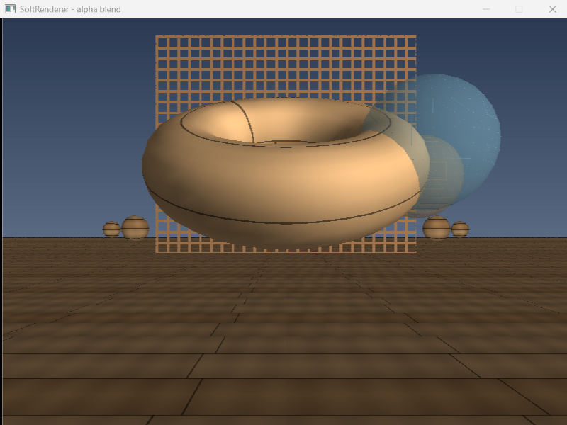
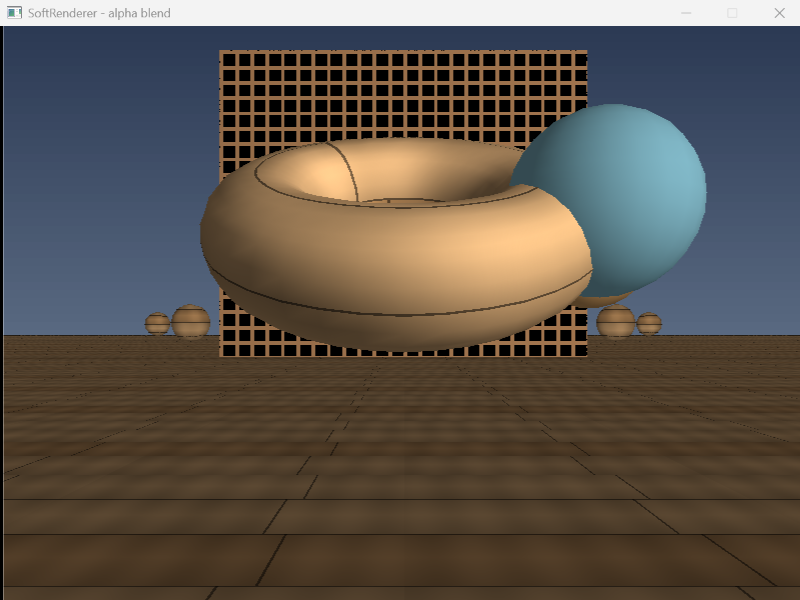

# 第 13 步：Alpha 测试 + 颜色混合，透明物体从远到近排（实现篇）

> 目标：给管线补上「不实心」的两种画法——**Alpha 测试**（镂空）和**颜色混合**（半透明），并顺手解决它们带来的那个大坑：**半透明物体必须从远到近画**。

> **验收标准（学习路线原文）**：半透明物体正确叠加。
> 本步的额外验收：镂空板的洞能看见后面的东西；两颗半透明球前后重叠时谁盖谁是对的；两个开关（`A` / `M`）关掉后效果分别退回「实心板」和「实心球」。

> **这份文档分两层读**：
> - **一 ~ 九**：主干。按「做什么 → 怎么实现 → 踩了什么坑 → 怎么验收」走一遍，通读用。
> - **[十、原理深挖](#十原理深挖四个卡点)**：四个最容易被问住的点的**完整推导**（为什么不可交换、为什么顺序是「测试→混合→写深度」、为什么半透明不写深度、状态包为什么是引擎标配）。**别一开始就读**，卡住的时候再翻。

---

## 一、这一步在做什么

| # | 做什么 | 动到的文件 |
| :---: | :--- | :--- |
| ① | **blend 模块**：Alpha 测试 + 颜色混合两个纯逻辑函数 | `src/render/blend.hpp` `.cpp`（新建） |
| ② | **DrawOptions**：把「怎么画」的一堆开关打包成状态结构 | `src/render/rasterizer.hpp` |
| ③ | **片元处理接入**：测试 → 混合 → 写深度 | `src/render/rasterizer.cpp` |
| ④ | 渲染入口签名从「一串 `bool`」换成 `const DrawOptions&` | `src/render/renderer.hpp` `.cpp` |
| ⑤ | **贴图支持 alpha**：生成镂空贴图；`modulate` / `sample_bilinear` 保留 alpha | `src/core/texture.hpp` `.cpp`、`src/render/rasterizer.cpp` |
| ⑥ | **`transparent` 标记 + 绘制排序**：不透明在前，半透明按距离从远到近 | `src/scene/scene.hpp` `.cpp` |
| ⑦ | **场景装配**：镂空后墙 + 两颗半透明玻璃球 | `src/main.cpp` |
| ⑧ | 改 CMake | `CMakeLists.txt` |

分层原则不变：`blend` 在 `render/`（只依赖 `core/color.hpp`，**不认识 SDL、不认识 Texture**，纯逻辑好测）。认识 SDL 的仍然只有那三个文件。

---

## 二、两种「不实心」，别混为一谈

第 13 步就两个效果，但它们**机制完全不同**，混着记一定会出错。

### 2.1 一张表说清区别

| | **Alpha 测试** | **颜色混合** |
| :--- | :--- | :--- |
| 片元的命运 | **二选一**：要么整个留下，要么整个丢掉 | **一定留下**，但留下方式不是覆盖 |
| 有没有中间状态 | 没有（不是 0 就是 1） | 有（`α` 从 0 到 1 连续变化） |
| 丢掉的片元写不写深度 | **不写** | （不存在「丢掉」） |
| 典型效果 | **镂空**：树叶、栅栏、铁丝网 | **半透明**：玻璃、水、火焰 |
| 典型贴图 | alpha 只有 0 和 255 两种值 | alpha 是 0~255 的连续值 |

一句话：

> **Alpha 测试是「一刀切」，颜色混合是「调浓度」。**

### 2.2 Alpha 测试：整个片元丢掉

判据只有一条，简单到不像话（[blend.cpp](file:///d:/SDL_project/softbymyself/src/render/blend.cpp#L7-L13)）：

```cpp
bool alpha_test(uint8_t alpha, uint8_t threshold)
{
    // 只有一条判据：alpha 达不到阈值就丢掉。
    // 阈值默认 128：0~127 的像素丢、128~255 的留。
    return alpha >= threshold;
}
```

返回 `false` 时，片元**不写颜色、不写深度**——等于它从来没来过。所以镂空板的洞是**真的洞**：背后的天空、地板、圆环照常画出来。

**阈值可调是有意义的**：同一张「树叶」贴图，阈值调低叶子更密、调高叶子更稀疏。这就是很多引擎里「Alpha Cutoff」滑条的来历。

### 2.3 颜色混合：加权平均

```
输出 = 源 × α + 目标 × (1 − α)        a = alpha / 255
```

- `a = 1` → 全是不透明的源，等价于直接覆盖（退化成没有混合）
- `a = 0` → 全是目标，等于没画
- `a = 0.5` → 各占一半，能同时看见源和目标

这就是最常说的「**正常混合 / alpha 混合**」（行话叫 `over` 运算）。[blend.cpp](file:///d:/SDL_project/softbymyself/src/render/blend.cpp#L15-L32)：

```cpp
Color blend_over(const Color& src, const Color& dst, uint8_t alpha)
{
    const float a  = static_cast<float>(alpha) / 255.0f;
    const float ia = 1.0f - a;

    // 逐通道加权平均。+0.5f 是四舍五入：
    // 直接截断的话，混合会让整幅画面系统性地偏暗一点点，叠多了能看出来。
    auto mix = [a, ia](uint8_t s, uint8_t d) -> uint8_t {
        const float v = static_cast<float>(s) * a + static_cast<float>(d) * ia;
        return static_cast<uint8_t>(std::clamp(v + 0.5f, 0.0f, 255.0f));
    };

    // 结果一律当成不透明（a = 255）
    return Color(mix(src.r, dst.r), mix(src.g, dst.g), mix(src.b, dst.b), 255);
}
```

> **`+0.5f` 不是可选的**：`static_cast<uint8_t>` 是**截断**（向下取整），不加 0.5 会让每个像素系统性偏暗一点点。一层看不出来，几十层半透明叠起来就是整体发灰。这是颜色计算里的通用习惯。

### 2.4 为什么两者都得在「深度测试之后」

它们都发生在**片元着色（拿到贴图颜色 + 光照）之后**，而且在**深度测试之后**。理由：

- **Alpha 测试在深度测试之后**：如果先做测试、再做深度测试，被丢掉的片元还得白白比一次深度（或者漏掉深度测试导致被丢弃的片元仍然写深度——那就不是镂空了）。
- **混合必须在深度测试之后**：混合要读「这个像素**已经画好**的颜色」，而深度测试决定「这个片元**配不配**画到这个像素上」。顺序反了就会拿还没画完的颜色去混。

片元里四步的**确切顺序**（[rasterizer.cpp](file:///d:/SDL_project/softbymyself/src/render/rasterizer.cpp#L475-L544)）：

```
① 插值 z → ② 深度测试（更远就丢）→ ③ 采样贴图 + 光照 → ④ Alpha 测试 → ⑤ 颜色混合 → ⑥ 写深度
```

> 「为什么是 Alpha 测试 → 混合 → 写深度，而不是别的排列」见 [十、原理深挖](#十原理深挖四个卡点) 的 10.2。

---

## 三、`DrawOptions`：把「怎么画」打包成状态

第 13 步之前，`draw_triangle_textured` 的签名尾巴上已经挂了两个 `bool`（`perspective_correct`、`bilinear`）。这一步又要加 4 个（`alpha_test`、`alpha_threshold`、`blend`、`write_depth`）。如果继续往签名上加：

```cpp
void draw_triangle_textured(..., bool perspective_correct, bool bilinear,
                            bool alpha_test, uint8_t alpha_threshold,
                            bool blend, bool write_depth);   // ← 六个参数挨着
```

两个 `bool` 挨在一起，调用点写错位置**编译器一句话都不说**（都是 `bool`），运行时才发现画面不对。

所以打包成结构体（[rasterizer.hpp](file:///d:/SDL_project/softbymyself/src/render/rasterizer.hpp#L108-L115)）：

```cpp
struct DrawOptions {
    bool    perspective_correct = true;   // UV 是否做透视校正（第 10 步）
    bool    bilinear            = false;  // 双线性 or 最近邻采样（第 10 步）
    bool    alpha_test          = false;  // 是否开 Alpha 测试（第 13 步）
    uint8_t alpha_threshold     = 128;    // alpha 低于它就丢弃
    bool    blend               = false;  // 是否开颜色混合（第 13 步）
    bool    write_depth         = true;   // 是否写深度（半透明物体要关掉）
};
```

三个好处：

- 加开关只改结构体，**函数签名不动**；
- 调用点写 `options.blend = true`，**名字自带说明**，不会传错位置；
- 一组状态可以**整个复制、整个往下传**（`DrawOptions opts = item.options;`）。

> **这不是本项目想出来的花活。** D3D 的 **PSO（Pipeline State Object）**、OpenGL 的 `glEnable` / `glBlendFunc` 组合、Vulkan 的 **`VkPipeline`**，都是同一件事：把「**怎么画**」和「**画什么**」分开——前者是状态，后者是数据。见 [十、原理深挖](#十原理深挖四个卡点) 的 10.4。

`main.cpp` 里就按物体类型挑三套状态（[main.cpp](file:///d:/SDL_project/softbymyself/src/main.cpp#L205-L211)）：

```cpp
DrawOptions opaque_opts;                    // 实心：写深度、无测试、无混合
DrawOptions alpha_opts;                     // 镂空：开 Alpha 测试
alpha_opts.alpha_test      = true;
alpha_opts.alpha_threshold = 128;
DrawOptions glass_opts;                     // 玻璃：开混合、不写深度
glass_opts.blend       = true;
glass_opts.write_depth = false;
```

---

## 四、大坑：混合不可交换 → 半透明必须从远到近

**这是本步最重要的一节。** 前面所有步骤，物体画的**顺序**都无所谓（有深度测试兜底）。这一步第一次出现「**顺序会改变结果**」。

### 4.1 为什么不可交换

`over` 运算**不满足交换律**：`A 混 B ≠ B 混 A`。

拿数字验一下。设 `A` 是红色、`α = 0.5`；`B` 是蓝色、`α = 0.5`；底是黑 `(0,0,0)`：

```
先画 A 再画 B：                       先画 B 再画 A：
  A over 黑 = (127,0,0)                B over 黑 = (0,0,127)
  B over 它 = (63,0,63)                A over 它 = (63,0,63)
```

这个例子里刚好一样（因为两者 `α` 相同）。换 `α` 不同就立刻分家：

```
A：红，α = 0.9                          B：蓝，α = 0.3

先 A 后 B：                             先 B 后 A：
  黑 → 红 0.9  → (229,0,0)               黑 → 蓝 0.3 → (0,0,76)
  再蓝 0.3     → (160, 0, 53)            再红 0.9    → (229, 0, 7)
```

**两个结果完全不同。** 物理上哪个对？——「先画 A 后画 B」意味着 **A 在 B 前面**（B 是透过 A 看到的背景，被 A 的 0.9 遮了一大半）。所以：

> **画的顺序 = 从「最远/最底层」到「最近/最上层」。** 半透明物体必须**从远到近**画。

### 4.2 半透明物体不写深度

半透明物体除了排序，还有一条硬约束：**不写深度**（`write_depth = false`）。

为什么？深度缓冲记录的是「**这个像素被谁占据了**」。半透明物体不占据像素——它只是**路过**，把自己叠上去。如果它写了深度，后画的一个更近的半透明片元就会**被它挡掉**，玻璃就变成一块死色（后面那些半透明层全被扔了）。

但注意：半透明物体**仍然要做深度测试**（[rasterizer.cpp](file:///d:/SDL_project/softbymyself/src/render/rasterizer.cpp#L478-L481)）：

```cpp
// 深度测试照旧。注意：半透明物体**也**要做这一步 ——
// 它虽然不写深度，但必须知道「自己前面有没有不透明的东西挡着」，
// 被挡住的部分就不该混进来（否则会把藏在前景后面的玻璃画到前面来）。
if (z >= fb.depth_at(x, y)) continue;   // 更远就不画
```

一句话区分：

> **不透明物体：既测又写。半透明物体：只测不写。**

- **测**：判断自己有没有被前面的**不透明**物挡住（被挡住就不该画）。
- **不写**：别去霸占像素，让后面更近的半透明层照样能叠上来。

### 4.3 `build_draw_order`：不透明在前，半透明从远到近

排序由 `Scene` 负责（[scene.cpp](file:///d:/SDL_project/softbymyself/src/scene/scene.cpp#L48-L82)）：

```cpp
std::vector<int> Scene::build_draw_order(const Vec3& eye) const
{
    std::vector<int> opaque;
    std::vector<int> transparent;

    // ① 先分成两拨（不是边遍历边排 —— 分组关系比大小关系更硬）
    for (int i = 0; i < static_cast<int>(objects_.size()); ++i) {
        const SceneObject& obj = objects_[i];
        if (!obj.visible) continue;
        (obj.transparent ? transparent : opaque).push_back(i);
    }

    // ② 半透明的那拨按「世界包围盒中心 → 眼睛」的平方距离从远到近排
    auto distance_sq = [&](int index) -> float {
        const SceneObject& obj = objects_[index];
        const Vec3 center = (obj.mesh->bounds.min + obj.mesh->bounds.max) * 0.5f;
        const Vec3 world_center = (obj.model * center).xyz();
        return (world_center - eye).length_squared();
    };

    std::stable_sort(transparent.begin(), transparent.end(),
                     [&](int a, int b) { return distance_sq(a) > distance_sq(b); });  // > 就是远→近

    // ③ 拼起来：不透明 + 半透明（从远到近）
    opaque.insert(opaque.end(), transparent.begin(), transparent.end());
    return opaque;
}
```

三个细节值得记：

- **分组而不是整体排序**：不透明物体之间谁先谁后——**无所谓**（有深度测试）。只有半透明那拨需要排序。所以先分组、再只排半个集合，省一半比较。
- **用平方距离**：只比大小，不开根号。
- **`stable_sort`**：距离相同时保持原顺序，画面不会一帧一帧地无谓抖动。

**为什么排的是「物体」不是「三角形」**：这是**近似**。严格正确的半透明排序要**逐三角形**排（甚至逐片元）、还要处理互相穿插的情况（A 和 B 在深度上互相交叉，谁前谁后都排不对）。真实渲染器里这一层**从来都是近似**，三角形级排序太贵，只有个别方案（比如 OIT，Order-Independent Transparency）才去啃这个硬骨头。本项目做到物体级就够。

---

## 五、踩坑记录：三个「alpha 被悄悄吃掉」的坑

本步有**三个**地方，只要有一处把 alpha 写死成 `255`，整个透明效果就全废，而且**症状都是「看起来没生效」，不知道是哪儿丢的**。把它们并排记下来。

### 5.1 `modulate` 把 alpha 写死成 255

贴图颜色要乘光照亮度。第 12 步之前的写法（[rasterizer.cpp](file:///d:/SDL_project/softbymyself/src/render/rasterizer.cpp#L191-L198)）：

```cpp
// 改之前：
return Color(f(c.r), f(c.g), f(c.b), 255);   // ← alpha 拍死 255
```

之前所有贴图都不透明，写死 255 没人看得出来。从第 13 步起贴图自带 alpha（玻璃、镂空栅栏），**在这里把 alpha 抹掉，后面 Alpha 测试和颜色混合拿到的永远是 255**——两个开关全部失效，但代码看着一点问题没有。

改成原样保留：

```cpp
// ⚠ 第 13 步：alpha 通道要原样保留，不能再写死 255。
//    光照只该压暗 RGB，跟透明度无关。
return Color(f(c.r), f(c.g), f(c.b), c.a);
```

### 5.2 `sample_bilinear` 把 alpha 写死成 255

同样的坑，藏在 `Texture` 里（[texture.cpp](file:///d:/SDL_project/softbymyself/src/core/texture.cpp#L82-L88)）：

```cpp
// 第 13 步：alpha 也要一起插值。
// 否则双线性采样会把半透明贴图拍成不透明（旧版这里写死 255），
// 一按 B 切到双线性，玻璃球就变成了实心球 —— 看起来像 bug，其实是丢了 alpha。
return Color(blend(c00.r, c10.r, c01.r, c11.r),
             blend(c00.g, c10.g, c01.g, c11.g),
             blend(c00.b, c10.b, c01.b, c11.b),
             blend(c00.a, c10.a, c01.a, c11.a));   // ← 第 4 个分量是 alpha
```

这个坑特别阴：**最近邻采样是对的**（`texel()` 原样返回整只 `Color`），只有切到双线性才露馅。所以症状是「**按一下 `B` 玻璃球突然变实心**」——很容易被当成双线性的 bug，其实是 alpha 在插值里被丢了。

### 5.3 `make_alpha_grid` 的底不能是「三参数构造」

生成镂空贴图时，先整张填成「全透明」：

```cpp
// 注意 alpha 必须显式写 0：Color(r,g,b) 那个三参数构造会把 alpha 补成 255，
// 拿它当底就等于整块实心板，洞全被填死了。
Texture t(size, size, Color(0, 0, 0, 0));   // ← 四参数，第四个是 0
```

`Color(r, g, b)` 会把 alpha 默认补成 `255`。写 `Color(0,0,0)` 当底，等于整块实心黑板，一个洞都没有。

### 5.4 教训

- **「默认 255」是这一整步的头号敌人。** 项目的 `Color` 三参数构造默认不透明，这在第 1~12 步完全正确（那时没有透明概念），到第 13 步就成了三个隐蔽 bug 的源头。**凡是「把颜色/纹理从一个地方搬到另一个地方」的代码，都要问一句：alpha 跟过来了吗？**
- **症状 → 排查方向**：整个透明效果都不生效 → 找「贴图取出来之后、用之前」这条链上的每一处 `Color(...)`；只有双线性不生效 → 直接看 `sample_bilinear`。

---

## 六、运行验收

程序跑起来（中文日志正常）：

```
[贴图] 已加载 assets/texture_wood.bmp（512×512）
[模型] 已加载 assets/models/torus.obj（861 顶点，1600 三角形）
[模型] 已加载 assets/models/sphere.obj（425 顶点，768 三角形）
[场景] 共 29 个物体（1 地板 + 1 圆环 + 24 小球 + 1 镂空墙 + 2 玻璃球）
[剔除] 可见 11 / 29
```

### 6.1 全部效果打开（`A` / `M` 默认开）



逐条对照：

| 验收点 | 画面证据 |
| :--- | :--- |
| **Alpha 测试生效（镂空）** | 后面那块板子能**透过栅格洞看见背后的天空**——洞是真的洞，不是画成黑色 |
| **颜色混合生效（半透明）** | 青色的玻璃球压住圆环右半边，**能透过它看见圆环**；琥珀球在后方，与青球部分重叠 |
| **绘制排序正确** | 两球重叠处，**近的青球压住远的琥珀球**——如果反了，重叠区域会呈现错误的前后关系 |
| **深度测试仍然生效** | 玻璃球**没有**穿到地板前面来，也没有盖住它不该盖的前景 |

### 6.2 把两个开关关掉（`A`、`M`）



同一视角下按 `A` / `M`：

| 开关 | 关掉后的画面 | 说明 |
| :--- | :--- | :--- |
| `A` Alpha 测试关 | 后墙**变成一整块实心板**（洞里露出贴图本身的颜色，不再是天空） | 片元不再被丢弃，`alpha = 0` 的格子照常画上去 |
| `M` 颜色混合关 | 玻璃球**变回实心球**（青色那颗不再透出后面的圆环） | 不再加权平均，直接覆盖；同时代码顺手把 `write_depth` 打开（见下） |

> 关掉混合时，`main.cpp` 顺手把 `write_depth` 也打开了（[main.cpp](file:///d:/SDL_project/softbymyself/src/main.cpp#L401-L406)）：不透明的东西要正常写深度，否则它会跟后面的物体乱插。**「关掉混合」等价于「这个物体变回不透明」，状态要整套跟着切**——这也正好体现了 `DrawOptions` 打包的好处。

---

## 七、本步新增/修改的文件

| 文件 | 状态 | 职责 |
| :--- | :--- | :--- |
| `src/render/blend.hpp` `.cpp` | **新建** | `alpha_test()`（二值剪裁）、`blend_over()`（加权混合）。纯逻辑，不碰 SDL/Texture |
| `src/render/rasterizer.hpp` | 改 | 新增 `DrawOptions`；`draw_triangle_textured` 收 `const DrawOptions&` |
| `src/render/rasterizer.cpp` | 改 | 片元四步：深度测试 → 采样+光照 → Alpha 测试 → 混合 → 写深度；`modulate` 保留 alpha |
| `src/render/renderer.hpp` `.cpp` | 改 | 渲染入口签名改收 `const DrawOptions&` |
| `src/core/texture.hpp` `.cpp` | 改 | 新增 `make_alpha_grid()`；`sample_bilinear` 插值 alpha |
| `src/scene/scene.hpp` `.cpp` | 改 | `SceneObject::transparent`；`build_draw_order()` 从远到近排序 |
| `src/main.cpp` | 改 | 三套 `DrawOptions`；镂空后墙 + 两颗玻璃球；`A`/`M` 开关 |
| `CMakeLists.txt` | 改 | 加入 `src/render/blend.cpp` |

**分层检查**：`blend.hpp` 只依赖 `core/color.hpp`（连 `math/` 都不依赖）。它不认识 `Texture`、不认识 `PixelBuffer`、不认识 SDL——只处理 `Color` 和 `uint8_t`。**纯逻辑层的好处就是好写单元测试**：`blend_over(Color(255,0,0), Color(0,0,0), 128)` 的结果可以一眼算出来。

---

## 八、自测题

1. Alpha 测试和颜色混合，最本质的区别是什么？各自典型用在什么地方？
2. 被 Alpha 测试丢掉的片元，写不写深度？为什么？
3. 混合公式写出来。`a = 0`、`a = 0.5`、`a = 1` 分别意味着什么？
4. 混合为什么加了 `+0.5f`？不加会怎样？
5. 为什么混合**不可交换**？举一个 `A 混 B ≠ B 混 A` 的数字例子。
6. 由此推出：半透明物体应该从远到近还是从近到远画？为什么？
7. 半透明物体「只测深度、不写深度」——测是为了什么，不写是为了什么？
8. 本步片元处理的确切顺序是什么？（深度测试、Alpha 测试、混合、写深度）
9. `modulate` 和 `sample_bilinear` 这两处「写死 255」的坑，症状分别是什么？
10. 为什么要排「物体」而不是「三角形」？这样做对吗？
11. `DrawOptions` 这种状态包，对应 D3D / OpenGL / Vulkan 里的什么？

**答不上来的，说明那一节没讲透——告诉我哪一题，我重写那一节。**
其中第 4、5、6、7 题的完整推导在 [十、原理深挖](#十原理深挖四个卡点) 里都有，答不出来直接翻过去。

---

## 九、这一步的产出物

| 产出物 | 可展示点 |
| :--- | :--- |
| `render/blend` 模块 | GitHub 里一个独立、可单测的混合模块（alpha test + over 运算） |
| 镂空 + 半透明同框截图（第 6 节） | 作品集里的一页：**「同一个场景里同时演示 Alpha 剪裁与半透明排序」** |
| `build_draw_order` | 一套物体级的渲染排序（不透明优先 + 半透明由远及近） |
| `DrawOptions` 状态结构 | 一个和真实引擎（PSO / VkPipeline）同构的渲染状态抽象 |

**面试关联**：

- 「半透明物体怎么渲染？」→ 从远到近排序、不写深度但测深度。**渲染岗高频题。**
- 「为什么半透明不写深度？」→ 答出「它只是路过像素，不拥有像素；写了深度会挡掉后面更近的半透明层」。
- 「混合为什么不可交换？」→ 能写 `over` 的公式并说明「谁在前谁在后决定了结果」，说明你懂它是个**顺序相关**的运算。
- 「Alpha 测试和 Alpha 混合有什么区别？」→ 一刀切 vs 调浓度；前者不写深度、后者只测不写。能分清这两个是专业度的分水岭。
- 「渲染状态为什么要打包成对象？」→ PSO / VkPipeline。能答出「把『怎么画』和『画什么』分开」，说明你理解现代图形 API 的设计动机。

---

## 十、原理深挖：四个卡点

> 上面一 ~ 九回答的是「**怎么做**」，这一节回答「**为什么能这么做**」。
> 挑的是四个最容易被学成「背结论」的地方。每一节都是同一套四拍：
> **① 把结论还原成一个真问题 → ② 先建立直觉 → ③ 一步步推 + 拿数字验 → ④ 它在管线里管哪一段 / 搞错会怎样**。

---

### 10.1 为什么混合不可交换

**① 问题**

第 4 节直接给了结论「从远到近画」。可为什么不交换？**这个『不可交换』从哪来的**——是个编程实现细节，还是数学本身的性质？

**② 直觉：每一步混合都在「往背景上盖一层半透明的纸」**

把每个已画好的像素颜色看成「**当前背景**」。每画一个半透明片元，就是在当前背景上**再盖一层半透明的纸**：

- 纸的颜色 = `src` 通道值
- 纸的不透明度 = `a`

盖的顺序不同，最终颜色不同——因为**后盖的纸，是盖在「已经包含前一张纸」的背景上**的。

**③ 推导：把两次混合展开**

设底色是 `C0`，先盖 A（颜色 `cA`、不透明度 `aA`），再盖 B（`cB`、`aB`）。

```
先 A 后 B：
  第一步： C1 = cA·aA + C0·(1−aA)
  第二步： C2 = cB·aB + C1·(1−aB)
             = cB·aB + [cA·aA + C0·(1−aA)]·(1−aB)
             = cB·aB + cA·aA·(1−aB) + C0·(1−aA)(1−aB)
```

注意 `C0` 前面那个系数 `(1−aA)(1−aB)`：**它是 A、B 两层的「总透过率」的乘积**，跟顺序无关（乘法交换）。顺序体现在**前两项**：

| 顺 | `cA` 的系数 | `cB` 的系数 |
| :--- | :--- | :--- |
| 先 A 后 B | `aA·(1−aB)` | `aB` |
| 先 B 后 A | `aB·(1−aA)` | `aA` |

**这两个系数不一样**（除非 `aA = aB` 或 `aA·aB = 0`）——这就是不可交换的来源。它还有很自然的物理解释：

> **先盖的那层，会被后盖的层挡掉一部分。** 先 A 后 B 时，A 的可见量是 `aA·(1−aB)`（A 自己的不透明度 × 透过 B 的比例）；而 B 在最外层，可见量就是 `aB`（没被谁挡）。

**拿数字验一遍**（前面 4.1 那组）：`aA = 0.9`（红），`aB = 0.3`（蓝），`C0 = 0`：

| 顺序 | 计算 | 结果 |
| :--- | :--- | :--- |
| 先 A 后 B | `C2 = 蓝·0.3 + 红·0.9·0.7 + 0` = `(0,0,76) + (160,0,0)` | `(160, 0, 76)` |
| 先 B 后 A | `C2 = 红·0.9 + 蓝·0.3·0.1 + 0` = `(229,0,0) + (0,0,7)` | `(229, 0, 7)` |

和 4.1 里算的两组数一致 —— **顺序确实改变结果**。（4.1 里那组 `α` 相同所以碰巧相等，正是「除非 `aA = aB`」的特例。）

**④ 它在管线里管哪一段 / 搞错会怎样**

「顺序不能换」→ 决定了**渲染排序**必须是管线的一部分，而且这个排序**只在半透明集合内部才有意义**（不透明集合有深度测试，顺序无所谓）。

搞错会怎样：

- **不排序 / 从近到远排**：半透明重叠处的前后关系**反了**。静止看可能不明显（颜色混出来还是「紫的」），但**一转视角、两个物体的前后关系互换，画面就会跳变/穿帮**。
- **给半透明也写深度**：后面的半透明层被第一个半透明层挡掉，玻璃变成一块死色，完全失去「透」的感觉。

---

### 10.2 为什么顺序是「测试 → 混合 → 写深度」

**① 问题**

[第二节](#24-为什么两者都得在深度测试之后) 直接给了顺序：深度测试 → 采样+光照 → Alpha 测试 → 混合 → 写深度。为什么是这个顺序？别的排列行不行？

**② 直觉：每一步都「依赖前一步的结论」，也「改变后一步要用的东西」**

按「数据依赖」来排就清楚了。把每一步当成一个小工序，看它**读什么、写什么**：

| 工序 | 读 | 写 |
| :--- | :--- | :--- |
| 深度测试 | 本片元的 `z`、`depth_at(x,y)` | （只决定去留） |
| 采样贴图 + 光照 | `uv`、`light` | 得到 `src` |
| Alpha 测试 | `src.a` | （只决定去留） |
| 颜色混合 | `src`、`get_pixel_color(x,y)` | `put_pixel(x,y)` |
| 写深度 | `z` | `set_depth(x,y)` |

**③ 推导：三对依赖关系**

1. **Alpha 测试要读 `src.a`，而 `src` 是「采样 + 光照」才有的** → 测试必须在采样之后。
   - 反过来（先测后采样）也不行：那时还没有 `alpha` 可测。
2. **Alpha 测试必须在深度测试之后**：被测试丢掉的片元，**一点副作用都不该有**（不写颜色、不写深度）。如果测试放在深度测试之前、而且丢了之后不写深度——那没问题；但如果实现成「测试通过才往下走、深度测试在更后面」，就要保证丢弃路径干净。本项目的做法是**测试紧贴落笔之前**，丢弃路径只有一个 `continue`，最不容易出错。
3. **混合要读 `dst = get_pixel_color(x,y)`——「这个像素**已经画好**的颜色」** → 混合必须在**所有会改这个像素的操作之前**。写深度不直接改颜色，但它会**影响后续**（别的物体）能不能画到这个像素上，所以：

```
正确：  混合（读 dst、写 color） → 写深度（写 depth）
错误：  写深度 → 混合
```

第二种排法的问题不在「混合读到错误的颜色」，而在**语义**：半透明物体**不该拥有这个像素**。所以本项目的做法是**干脆不给半透明物体写深度**（`write_depth = false`）——顺序问题直接消解。

**④ 它在管线里管哪一段 / 记住一句话**

这个顺序是「**输出合并（Output Merger）**」阶段内部的顺序，也就是管线的最后一段。一句话记：

> **先判断「留不留」（深度测试 + Alpha 测试），再决定「怎么留下」（覆盖 or 混合），最后才「登记归谁」（写深度）。**

搞错会怎样：

- **测试放在混合之后**：一个本该被镂空丢掉的片元，先跟背景混了一遍才被丢——**观察者看到的是「混了一半」的脏颜色**（因为混合已经改了像素，`continue` 也追不回来）。
- **写深度放在混合之前**（且半透明也写深度）：后面的半透明层被挡掉，玻璃变死色。

---

### 10.3 为什么半透明「只测不写」深度

**① 问题**

[4.2](#42-半透明物体不写深度) 给了结论「只测不写」。可深度测试和写深度为什么能**拆开**？它们不是一回事吗？

**② 直觉：深度测试是「问」，写深度是「记」**

一句话点破：

> **深度测试是「读出别人记下的深度，跟自己比一比」；写深度是「把自己的深度记下来，给别人比」。**

一个是**读**，一个是**写**。两者读/写的都是同一张深度图，但**动作**完全不同，当然可以拆开。

- **测试（读）**：我需要知道「我前面有没有东西挡着」——这个信息对我**有价值**（被挡住的就不画）。
- **写（记）**：我需要告诉后来者「这个像素被我占了」——但半透明物体**不配**说这句话，因为它没有「占据」像素，只是路过了。

**③ 推导：如果半透明也写深度，会发生什么**

场景：两个半透明球，青球在近、琥珀球在远；相机看向它们。**从远到近画**（正确排序）：

```
① 画琥珀球（远）：
   测试：深度图是空的 → 通过
   混合：dst = 背景，结果 = 琥珀 α 混背景
   写深度？ → 如果写，深度图现在记下「琥珀球的深度」

② 画青球（近）：
   测试：z 比深度图里的「琥珀球深度」更近 → 通过 ✓
   混合：dst = 「琥珀混背景」→ 再叠上青 ✓
   写深度？ → 如果写，覆盖成青球深度

结果：两颗球都叠上了，看起来「都对」……但错在别处。
```

等一下，这个例子里「写了深度」好像也没出错？对——**因为按从远到近画，后画的总是更近、总能通过测试**。错在**更一般的情况**：一个半透明物体**部分被另一个半透明物体挡住**时（不是整块前后，而是互相穿插），先画的写了深度，后画的那部分就会被**整块挡掉**，而不是混合。于是两个球的重叠区域会**丢掉一层**——看起来像「谁把谁抠掉了一块」。

更典型的翻车现场是**单个半透明物体自己**：一个玻璃球有正面和背面两层。从远到近画，**背面先画、正面后画**。若背面写了深度，正面（更近）通过测试、混上去，还是对的……但如果**同一物体内部的三角形顺序不理想**（物体级排序只能保证物体之间，物体内部三角形没排），先画了某个「靠前」的三角形并写了深度，后面那个本该混合的「靠后」三角形就被挡掉了 → 玻璃球出现**明暗不均的硬边块**，而不是平滑的半透明。

所以「不写深度」的真正意义是：

> **半透明物体不参与「遮挡关系」的建立。** 深度图只记录**不透明**世界的形状，半透明层像一层层「贴膜」叠在这个形状（和背景）上，谁都不改变「谁是实体」。

**④ 它在管线里管哪一段 / 搞错会怎样**

它管的是「**半透明物体在深度图里的身份**」——答案是「临时访客，不留痕」。搞错会怎样：

- **半透明写了深度** → 后画（更近）的半透明层通过测试没问题，但**同层内部的层与层之间**开始互相遮挡；玻璃表面出现硬边、深色块、忽明忽暗。转视角时最明显。
- **不透明物体不写深度** → 立刻全乱：所有东西互相穿透，深度测试形同虚设。

两条对照起来记：**不透明「既测又写」，半透明「只测不写」。**

---

### 10.4 为什么要打包成 `DrawOptions`（PSO / VkPipeline）

**① 问题**

`DrawOptions` 看着就是个「省参数的封装」，是工程洁癖吗？为什么 D3D / Vulkan 要为此专门发明 PSO / Pipeline 这种**一等公民**的对象？

**② 直觉：「画什么」和「怎么画」是两类完全不同的信息**

- **画什么**（数据）：顶点、索引、贴图——每个物体都不一样，量大、常变。
- **怎么画**（状态）：透视校正、采样方式、混合开关、深度写不写——**一批物体往往共用同一套**，种类少、变化少。

把这两类混在一张函数签名里，会有三个具体问题：

1. **参数爆炸**：每加一个开关就改一次签名，几十个调用点跟着改。
2. **传参易错**：两个 `bool` 挨着，谁是谁全靠记，编译器帮不上忙。
3. **没法预校验**：真实 API 里「状态组合」有些是非法的（比如「不开混合却要调混合系数」），分开散着传就没地方检查。

**③ 推导：现代 API 为什么把它抬成对象**

真实 GPU 驱动里，改渲染状态是**有成本**的——驱动要校验组合合法性、重新配置硬件流水线。状态一多、切换一频繁，这个成本就很可观。于是现代 API 的做法是：

> **把一整套状态**预先**编译成一个不可变对象**，运行时只做「切换到这个对象」，成本变成一次指针引用。

| API | 一辈子的叫法 |
| :--- | :--- |
| Direct3D 12 | **PSO**（Pipeline State Object） |
| Vulkan | **`VkPipeline`** |
| Metal | **`MTLRenderPipelineState`** |
| OpenGL（老） | 没有对象，就是一堆 `glEnable` / `glBlendFunc` 的**全局状态**——所以老 GL 的状态管理 notoriously 容易出错 |

本项目的 `DrawOptions` 就是**这个思想的最小版本**：一个值对象，一次传下去，加开关不动签名。它没有「预编译」这一步（软渲染不需要），但**「把怎么画和画什么分开」这个核心思想是同一个**。

**④ 它在管线里管哪一段 / 搞错会怎样**

它管的是「**每一次绘制调用（draw call）的上下文**」。搞错（状态没跟着物体切换）会怎样：

- 半透明物体用了 `opaque_opts`（写深度）→ 见 10.3，玻璃变死色。
- 镂空物体忘了开 `alpha_test` → 镂空板变实心板。
- 全局开关（`T`/`B`）覆盖的时候漏掉了某个状态 → 按 `B` 没反应，或者只在部分物体上生效。

这也是 [main.cpp](file:///d:/SDL_project/softbymyself/src/main.cpp#L395-L406) 那段「把全局开关覆盖进这个物体的状态里」的写法为什么重要：

```cpp
DrawOptions opts = item.options;          // 先拿这个物体自己的状态
opts.perspective_correct = perspective_correct;   // 再覆盖全场统一的
opts.bilinear            = bilinear;
if (!alpha_test_on) { opts.alpha_test = false; }
if (!blend_on && opts.blend) { opts.blend = false; opts.write_depth = true; }
```

**「从物体自己的状态出发，覆盖全局开关」**——顺序不能反，否则物体特有的设置会被全局默认值冲掉。这就是状态包带来的一个必须记住的用法约定。

---

## 十一、下一步

**阶段 D（11–13）到此收官。** 到这里，管线已经完整了：

```
顶点输入 → MVP → 裁剪空间 → 近平面裁剪 → 透视除法 → NDC → 视口 → 屏幕空间
        → 背面剔除 → 光栅化（重心坐标 + 透视校正）→ 深度测试
        → 采样贴图 + 光照 → Alpha 测试 → 颜色混合 → 帧缓冲
```

再往前（**学习路线之外**，属于「你想往哪个方向走」的选择）：

| 方向 | 下一步可以做什么 |
| :--- | :--- |
| **技术美术 / 渲染** | 环境光遮蔽（AO）、阴影贴图（Shadow Map）、法线贴图、后处理（泛光 Blooom / 色调映射） |
| **引擎** | 场景图 / 组件系统、多材质模型（`.mtl`）、资源的统一管理 |
| **性能** | 多线程光栅化、SIMD、增量式边函数 |
| **作品集** | 把 11–13 的截图整理成一页「软渲染器：管线全流程」，配上第 11 步那个 bug 的故事 |

> **给备考期的一个提醒**：到这里，这个项目已经**足够作为一个作品集条目**了（自研软渲染器 + 完整管线 + 两次真实 bug 定位）。如果初试临近，**不要**再往上面加新特性，把时间还给数学和专业课；把这个项目**整理、写好 README、截好图**就够了。新特性留到考完再补。
